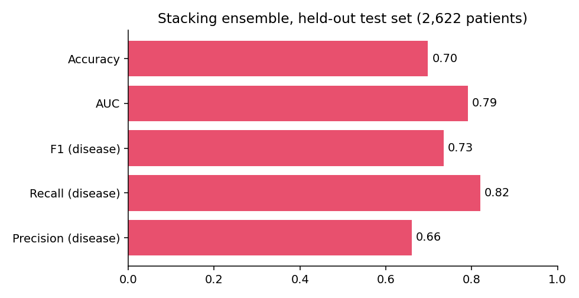
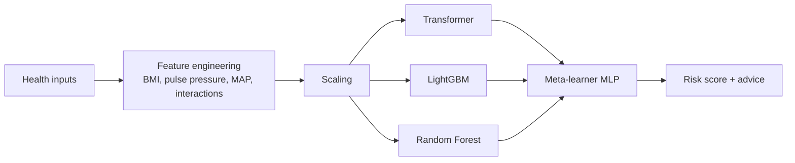

# 🫀 Transformer Heart Disease Prediction System

**Cardiovascular risk prediction with a Transformer + LightGBM + Random Forest stacking ensemble, feature selection by a Genetic Algorithm, tuning by Particle Swarm Optimization, and a full Streamlit web app.**

Enter a few health numbers (age, blood pressure, cholesterol, BMI, lifestyle) and get a 0 to 100% risk score, a risk level, and personalised advice.



## ✨ What it does

| | |
|---|---|
| 🧠 **Stacking ensemble** | A Transformer, LightGBM and Random Forest each predict risk. A small neural meta-learner combines them. |
| 🧬 **Genetic Algorithm** | Picks the most useful features from the 21 engineered ones. |
| 🐝 **Particle Swarm Optimization** | Tunes model hyperparameters. |
| 🩺 **Smart risk score** | Blends the ensemble with clinical rules and a statistical check for a 0 to 100% score. |
| 👥 **Roles** | Patient, doctor and admin accounts, alerts, doctor notes, patient history. |
| 💡 **Lifestyle coach, what-if analysis** | See how quitting smoking or losing weight changes risk. |
| 📈 **Explainability** | Per-prediction risk factors and feature importance. |
| 🫀 **3D heart viewer, ECG page** | Interactive 3D heart with disease states and blood flow, plus an ECG analysis page. |

## 🔬 How it works



## 📊 Results

Measured on a held-out test set of 2,622 patients (from `final_models/stacking_results.json`):

| Metric | Score |
|---|---|
| Accuracy | 0.70 |
| AUC | 0.79 |
| F1 (disease class) | 0.73 |
| Recall (disease class) | 0.82 |

The model is tuned to catch most people who have disease (recall 0.82), at the cost of some false alarms (precision 0.66).

## 🚀 Quick start

```bash
git clone https://github.com/jpoojaj/transformer-heart-disease-prediction-system.git
cd transformer-heart-disease-prediction-system
python -m venv .venv && source .venv/bin/activate   # Windows: .venv\Scripts\activate
pip install -r backend/requirements.txt
cp .env.example .env        # then edit .env
cd backend
streamlit run app.py
```

Open the link Streamlit prints, register a user (6-digit password), then use **Risk Prediction**.

## 🔑 Use your own keys

This repo contains **no API keys**. `.env` is git-ignored. Copy `.env.example` to `.env` and put **your own** keys there (Google client ID/secret, Supabase URL/key). Never commit your `.env` and never use someone else's keys.

## 🗂️ Project structure

```
backend/
  app.py                      Streamlit app (all pages)
  src/database.py             SQLite users, assessments, alerts
  src/risk_prediction/
    feature_engineering.py    Feature engineering + raw-to-model scaling
    genetic_feature_selection.py
    particle_swarm_optimization.py
    cardiovascular_transformer.py
    comprehensive_stacking_ensemble.py
    cardiovascular_risk_calculator.py
    final_models/             Trained models
```

## 🛠️ Built with

Python, PyTorch, scikit-learn, LightGBM, Optuna, DEAP, SHAP, LIME, Streamlit, SQLite.
